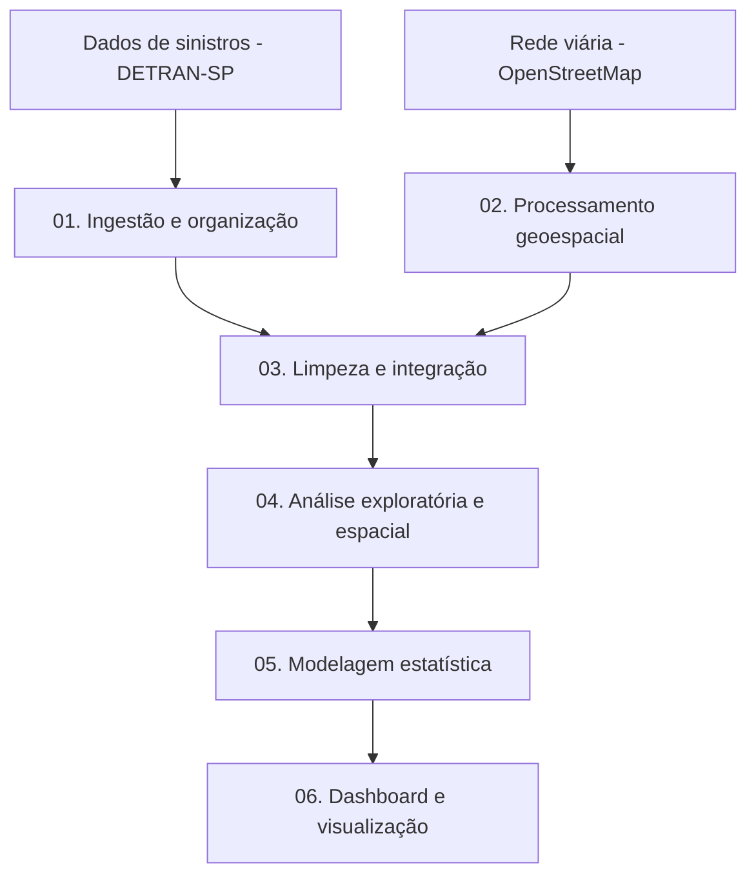

# Análise Geoespacial de Sinistros Envolvendo Ciclistas na Baixada Santista

> Pipeline de Ciência de Dados para integração, processamento, análise espacial e modelagem estatística de sinistros de trânsito envolvendo bicicletas.

## Sobre o projeto

Este projeto desenvolve um pipeline de dados voltado à análise da segurança viária de ciclistas nas cidades Santos, Praia Grande e São Vicente, São Paulo, integrando registros de sinistros de trânsito a informações geográficas da infraestrutura viária.

A proposta é investigar como as características espaciais da rede viária, os limites de velocidade das vias e a distribuição temporal dos registros se relacionam com a ocorrência e a gravidade dos sinistros envolvendo bicicletas.

O pipeline contempla desde a preparação e integração dos dados até a aplicação de métodos estatísticos, o processamento de informações geoespaciais e a disponibilização de resultados em um dashboard.

## Objetivo científico

Investigar a associação entre a estrutura espacial da rede viária utilizada por bicicletas, as características dos segmentos viários e a ocorrência, a gravidade e a distribuição temporal dos sinistros envolvendo ciclistas nas cidades escolhidas.

### Questões investigadas

- Como os sinistros se distribuem espacialmente entre os municípios e os segmentos viários?
- Existe associação entre os limites de velocidade das vias e a ocorrência ou gravidade dos sinistros?
- Quais padrões temporais podem ser identificados nos registros?
- Quais áreas e segmentos viários apresentam maior concentração de ocorrências?
- Qual modelo estatístico representa melhor os dados analisados, considerando suas características de dispersão?

## Pipeline de dados

O projeto é organizado em etapas sequenciais, permitindo rastrear o processamento desde os dados originais até os resultados analíticos.



### Etapas do processamento

**01. Ingestão de dados**

- Leitura e consolidação dos arquivos de sinistros.
- Organização dos dados por período (2020-2025).
- Padronização inicial das estruturas de entrada.
- Limitação do tipo sinistro útilizado
- Tratamento de coordenadas e sistemas de referência espacial.

**02. Processamento geoespacial**

- Obtenção e preparação da rede bicicletária.
- Extração de atributos viários disponíveis, incluindo limites de velocidade e características dos segmentos.
- Integração espacial dos registros de sinistros com a infraestrutura viária.

**03. Limpeza e integração**

- Padronização de nomes de colunas e categorias.
- Tratamento de valores ausentes e inconsistências.
- Preparação das variáveis temporais, espaciais e de gravidade.
- Geração das bases utilizadas nas etapas seguintes.
- Caluculo das métricas de grafo dos segmentos: Betwenees e Closenees

**04. Análise exploratória e espacial**

- Distribuição dos registros por município, período e gravidade.
- Identificação de concentrações espaciais.
- Análise das características dos segmentos viários associados aos registros.
- Produção de mapas temáticos e indicadores espaciais.

**05. Modelagem estatística**

- Avaliação da distribuição da variável resposta.
- Aplicação de regressão de Poisson ou binomial negativa, conforme as características dos dados e os diagnósticos dos modelos.
- Análise de associações com variáveis viárias e temporais.
- Interpretação dos coeficientes e das razões de taxas de incidência (IRR), quando apropriado.

**06. Dashboard**

- Apresentação interativa dos resultados.
- Visualização geográfica dos sinistros.
- Filtro por município
- Exibição dos resultados estatísticos produzidos pelo pipeline.

## Tecnologias utilizadas

| Tecnologia | Aplicação |
|---|---|
| Python | Orquestração e processamento dos dados |
| Pandas | Limpeza, transformação e integração tabular |
| GeoPandas | Manipulação de dados vetoriais geográficos |
| OSMnx / OpenStreetMap | Obtenção e análise da rede viária |
| Statsmodels | Modelagem estatística |
| Scikit-learn | Ferramentas auxiliares de análise e avaliação, quando aplicáveis |
| Folium | Mapas interativos, conforme a implementação |
| Streamlit / plotly | Dashboard e visualizações, conforme a implementação |

## Estrutura do repositório

```text
projeto-sinistros-ciclistas/
│
├── README.md
├── requirements.txt
├── app.py
├── config.py
├── datasets_segmentos_municipios.csv
│
├── dados/
│   ├── raw/
│   ├── resultados/
│   ├── cache/
│   └── processados/
│
├── scripts/
│   ├── 01_etl/
│   ├── 02_mapa_espacial/
│   └── 03_analise_estatistica/
│
├── resultados_estatisticos/
│   ├── comparacao_modelos/
│   ├── dashboard_kpis/
│   ├── irr_municipios/
│   └── ranking_segmentos/
│
├── resultados_mapa_espacial/
│   ├── dastasets_segmentos_associados/
│   ├── datasets_segmentos_nao_associados/
│   ├── dataset_segmentos/
│   └── mapas/
```

### Organização das principais pastas

- `dados/raw/`: arquivos originais utilizados como entrada.
- `dados/processados/`: bases geradas durante as transformações.
- `dados/processados/`: bases preparadas para análises e modelos.
- `codigos/`: scripts responsáveis por cada etapa do pipeline.
- `resultados_estatisticos/`: tabelas dos resultados das analises para os graficos.
- `resultados_mapa_espacial/`: tabelas, mapas relacionados aos segmentos do grafo espacial dos sinistros.

## Fontes de dados

### DETRAN-SP

Registros de sinistros de trânsito utilizados para identificar ocorrências envolvendo bicicletas, suas características temporais, localização e informações de gravidade.

- Portal institucional: https://www.detran.sp.gov.br/

### OpenStreetMap

Dados geográficos utilizados para representar a infraestrutura viária e obter atributos disponíveis dos segmentos, como classificação da via e limite de velocidade.

- Site: https://www.openstreetmap.org/
- Documentação: https://wiki.openstreetmap.org/

A disponibilidade e a completude dos atributos podem variar entre segmentos. A ausência de um limite de velocidade no OpenStreetMap não deve ser interpretada automaticamente como ausência de regulamentação.

### Período de análise

**Período previsto:** 2020–2025.

## Metodologia estatística

A seleção dos métodos depende da unidade de análise, da definição da variável resposta e das características empíricas dos dados.

| Método | Finalidade |
|---|---|
| Estatística descritiva | Caracterizar os registros e as variáveis |
| Análise exploratória espacial | Investigar padrões e concentrações geográficas |
| Correlação de Spearman | Avaliar associações monotônicas entre variáveis adequadas |
| Regressão de Poisson | Modelar contagens sob hipóteses compatíveis com os dados |
| Regressão binomial negativa | Alternativa para contagens com sobredispersão |
| IRR (razão de taxas de incidência) | Interpretar associações estimadas pelos modelos de contagem |

A escolha entre Poisson e binomial negativa deve ser fundamentada em diagnósticos, dispersão, ajuste e adequação do modelo. A utilização de uma variável offset depende da existência de uma medida de exposição apropriada, como fluxo de ciclistas, extensão viária ou tempo de observação, conforme a unidade de análise.

Os resultados observacionais indicam associações estatísticas e não demonstram, isoladamente, relações causais.

## Como executar

### 1. Clonar o repositório

```bash
git clone <URL_SSH_DO_REPOSITORIO>
cd projeto-sinistros-ciclistas
```

### 2. Criar um ambiente virtual

No Windows:

```bash
python -m venv .venv
.venv\Scripts\activate
```

### 3. Instalar as dependências

```bash
python -m pip install --upgrade pip
pip install -r requirements.txt
```

### 4. Configurar os dados

Disponibilize os arquivos de entrada nos diretórios esperados pelos scripts. Caso os dados não estejam versionados, ajuste os caminhos de leitura para a estrutura local.

### 5. Executar o pipeline

Execute os scripts na ordem definida pela implementação do projeto: ingestão, processamento, integração geoespacial, análise e modelagem.

```bash
python caminho/do/script_inicial.py
```

Substitua o caminho de exemplo pelo nome real do primeiro script. Os demais comandos devem ser documentados conforme os arquivos efetivamente existentes.

### 6. Executar o dashboard

Utilize o comando correspondente à tecnologia adotada:

```bash
streamlit run caminho/do/dashboard.py
```

## Limitações

Os resultados dependem da qualidade e da cobertura dos registros de sinistros e dos dados geográficos utilizados. Registros sem coordenadas válidas, atributos viários incompletos e diferenças na cobertura espacial podem afetar as análises.

Além disso, a quantidade de sinistros registrada em determinado segmento não equivale diretamente ao risco individual de um ciclista. Para estimar taxas de risco, é necessário considerar medidas adequadas de exposição, como volume de ciclistas ou outra aproximação justificável.

## Status do projeto

**Status:** em desenvolvimento.

As etapas implementadas, os modelos validados e os resultados finais serão documentados à medida que o pipeline for consolidado.

## Autor

Desenvolvido como projeto acadêmico na área de Ciência de Dados, com foco em análise geoespacial, mobilidade urbana e segurança viária.

## Licença

A fazer
